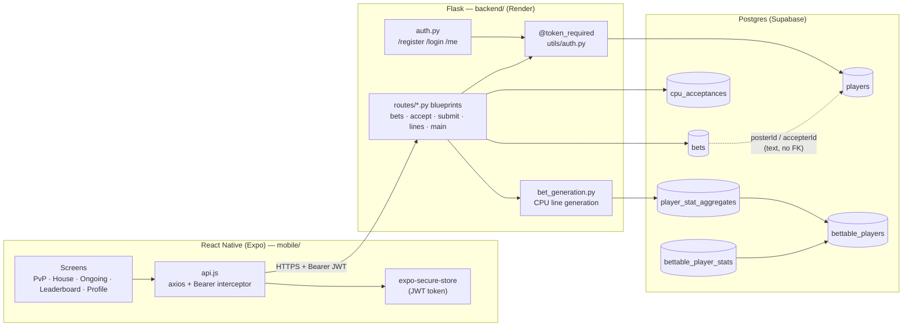
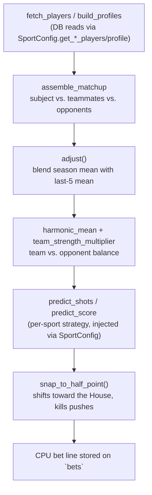

# Patio — Architecture

## Full-stack overview

Two identity spaces meet only at `bets`: the **account world** (`players` — logins, caps balance)
and the **stats world** (`bettable_players` → `bettable_player_stats` → `player_stat_aggregates` —
the people named *in* a game, who need not be app users at all). See `DATABASE.md` for the full
schema reference this diagram is derived from.

## Bet-generation flow (CPU/House lines)

The shared pipeline (fetch → profiles → matchup → balance) is identical for Caps, Pong, and
Beerball. Only the final `predict_shots`/`predict_score` step is sport-specific, injected through
a `SportConfig` dataclass — see [Sport module collapse](#sport-module-collapse-3-file—1-file)
below.

---

## Portfolio talking points

### Sport module collapse (3-file → 1-file)

**Before:** `caps_bet_generation.py`, `pong_bet_generation.py`, and `beerball_bet_generation.py`
each independently implemented the same shape of pipeline — fetch player stats, build a matchup,
weigh team strength, bias the line toward the House, snap to a half-point — with the sport-specific
math (DV, teammate suppression, differing `opportunity_factor` signatures) duplicated and drifting
slightly across the three files.

**After:** one parameterized `backend/bet_generation.py`. The pipeline stages that were byte-for-byte
identical across sports (`adjust`, `harmonic_mean`, `team_strength_multiplier`, `snap_to_half_point`)
were pulled out once; the stages that genuinely differ per sport were kept explicit rather than
force-fit into a single abstraction, and injected through a `SportConfig` dataclass holding each
sport's DB-read callables and its `predict_shots`/`predict_score` strategy function. Pong's shots
prediction needs a cursor + team size for a global average; Beerball's needs win-rate and defensive-value
inputs that Caps doesn't have at all — the seam accepts that asymmetry instead of hiding it behind a
lowest-common-denominator interface.

**Correctness gate:** a golden-master test (`tests/test_golden_master_3_1.py`) captured every original
module's line output for a fixed set of inputs *before* the refactor and asserts the new module
reproduces it byte-for-byte, per sport and line type. The collapse was verified behavior-preserving,
not just "looks equivalent."

**Why it matters:** three files that quietly drifted became one file where a shared-pipeline bug fix
(or a future ML-backed `predict_expected_stat` swap-in) lands once, not three times, and the diff for
"what's actually different between Caps and Beerball" is now the size of the difference — not the
size of three duplicated pipelines.

### Web → mobile conversion (CRA → React Native/Expo)

**Before:** a Create React App web frontend (`src/`) talking to the Flask API over cookies +
`localStorage`, deployed on Vercel.

**After:** a React Native (Expo) app (`mobile/`) is the shipping target — the CRA app stays running
unmodified alongside it until mobile reaches parity (unscheduled retirement, item X.6), so there's
no big-bang cutover risk. The conversion is a decided, not incidental, architecture choice:

- **Auth storage:** `localStorage` → `expo-secure-store`. Native apps have no cookie jar worth
  building session state on top of, so the app moved to a header-token pattern exclusively — same
  `Authorization: Bearer` interceptor shape as the web app, different storage backend underneath it.
- **Navigation:** React Router's page-based routing → React Navigation's native-stack (auth flow) +
  bottom-tabs (the five main screens), matching the platform's own navigation idioms instead of
  reproducing a browser's back-button model.
- **UI primitives:** DOM/JSX (`div`/`button`, CSS files, `lucide-react`, `window.confirm`) → RN
  primitives (`View`/`Pressable`/`FlatList`, co-located `StyleSheet.create`, `lucide-react-native`,
  RN `Alert`) — a real port, not a wrapper around a webview.
- **Scope discipline:** the Messages page (a 17-line stub with no backend behind it) was explicitly
  *not* ported — cut rather than carried forward as dead weight, since a real messaging feature on
  iOS needs its own auth/table/push-notification/Guideline-1.2 UGC stack if it's ever built (item
  X.4), and porting a stub would have just relocated the debt.

**Why it matters:** the port surfaced (and forced fixes for) real backend bugs that the web app had
been silently eating — the `/me` endpoint and the camelCase-column reads (`/pvp_bets`, `/cpu_bets`,
`/ongoing_bets`) were 500ing before the mobile conversion made them impossible to ignore.
